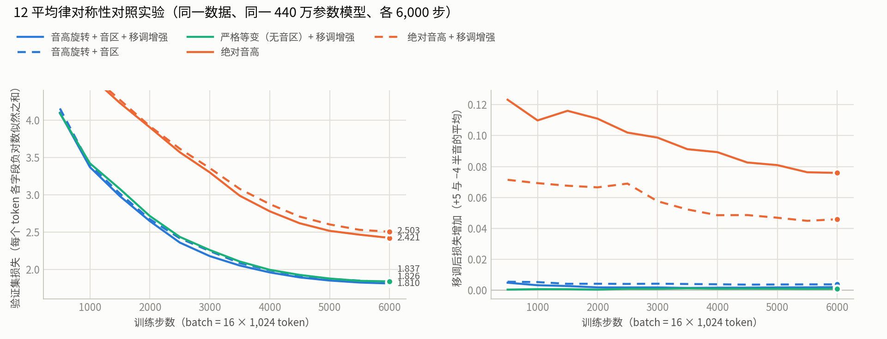

# 12 平均律对称性对照实验（2026-09-28）

结论：**把音高改成相对的（音高旋转编码 + 预测音程），验证损失降低约 25%，达到同样损失所需的步数约为 2/5，而且移调后几乎不变。** 下一步的网页版和离线版都用"音高旋转 + 音区 + 移调增强"这一组设置。



## 设置

- **数据**：SymphonyNet 共 46,360 个 MIDI 文件，保留 43,036 首，2.06 亿个音符、557 万个小节。
  - 跳过的文件：1,948 个不在量化网格上，1,118 个重复，251 个拍号无法使用，7 个太短。
  - 划分：训练 42,163 首，验证 438 首，测试 435 首。
- **模型**：五种设置都用同一个模型，参数约 440 万（d=256、4 层、4 头、FFN 1,024），上下文 1,024 个 token，batch 16，各训练 6,000 步。学习率、种子和数据顺序也相同。
- **机器**：M2 Pro，16 GB 内存，16 核 GPU，PyTorch 2.14 的 MPS 后端。每种设置每秒约 2.2–2.8 万个 token，训练 52–75 分钟。
- **评估**：192 个固定的验证窗口，约 19 万个 token，评估三次：原调，以及整体移调 +5 和 −4 个半音。

## 结果（第 6,000 步）

每个 token 各字段负对数似然之和，越低越好。

| 设置 | 验证 | 移调 +5 | 移调 −4 | 音高 CE（每个音） | 首次降到 2.421 的步数 |
|---|---:|---:|---:|---:|---:|
| 绝对音高 | 2.421 | 2.496 | 2.497 | 1.029 | 6,000 |
| 绝对音高 + 移调增强 | 2.503 | 2.563 | 2.535 | 1.075 | 未达到 |
| 音高旋转 + 音区 | 1.826 | 1.830 | 1.830 | 0.728 | 2,500 |
| **音高旋转 + 音区 + 移调增强** | **1.810** | **1.813** | **1.811** | **0.718** | 2,500 |
| 严格等变（无音区）+ 移调增强 | 1.837 | 1.838 | 1.838 | 0.730 | 3,000 |

各字段的交叉熵（验证，原调）：

| 设置 | 位置 | 组 | 音高 | 时值 | 力度 | 速度 |
|---|---:|---:|---:|---:|---:|---:|
| 绝对音高 | 0.173 | 0.375 | 1.029 | 0.475 | 0.354 | 0.625 |
| 音高旋转 + 音区 + 移调增强 | 0.123 | 0.293 | 0.718 | 0.391 | 0.274 | 0.288 |

- **相对音高的收益最大。** 音高的交叉熵从 1.03 降到 0.72（每个音少 0.31 nat）。位置、组、时值、力度也都降了 18–29%。音程结构不只帮助预测音高，也帮助预测什么时候出音、由哪组演奏、持续多久。
- **移调后绝对音高模型变差，旋转模型几乎不变。**
  - 绝对音高模型在移调后的验证集上损失增加 0.076；加了移调增强也还有 0.046。
  - 旋转模型只增加 0.001–0.004。严格等变的模型理论上为 0，残余来自窗口开头固定的锚点。
- **只看同一族时：**
  - 移调增强对旋转模型略有帮助：1.826 → 1.810。
  - 移调增强对绝对音高模型反而有害：6,000 步内它要把 12 个调分别学一遍。
  - 保留粗音区略好：1.810，严格等变为 1.837。乐器音域和音色确实取决于绝对音区。

## 生成样例的粗略统计

每个模型 8 个样例，各 8 小节，从同样的开头开始，乐器组全部自动。

| 模型 | 温度 | 每小节音符 | 落在最匹配自然音阶内的比例 | 完全重复上一小节的比例 |
|---|---:|---:|---:|---:|
| 音高旋转 + 音区 + 移调增强 | 1.0 | 24.9 | 92% | 4% |
| 绝对音高 | 1.0 | 17.3 | 90% | 2% |
| 音高旋转 + 音区 + 移调增强 | 0.9 | 22.5 | 96% | 2% |
| 绝对音高 | 0.9 | 12.4 | 94% | 5% |

这些只是很粗的指标。两个模型的调性都基本成立，旋转模型写得更密。

听样例时注意到三个问题：
- 有的样例会长时间重复同一个音型；
- 只开弦乐时，高音弦乐有时写得很低、很密；
- 小模型、6,000 步，还远没有训练充分。

## 局限

- **每种设置只跑了一次**：同一种子，没有误差条。不过旋转与绝对之间 0.6 的差距，远大于同族内部 0.01–0.03 的差别。
- **步数短**：只训练了 6,000 步。joint-v1 的经验是，通用模型给足训练后能追平带结构先验的模型。这里的对称性是严格的，差距很可能会缩小，但不太可能消失；训练更久才能确定。

## 复现

```sh
bash mac.sh ablation                                   # 5 个设置依次训练
python plot_ablation.py work/runs ablation-curves.png  # 本页的图
```
