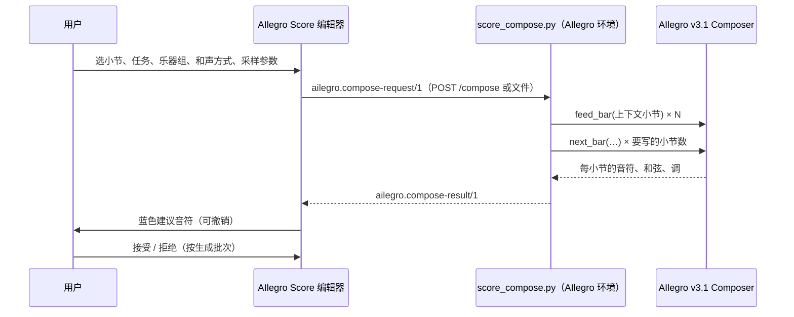

# 与 AIlegro 的接口

AIlegro 是项目所有者的 AI 作曲 / 续写 / 配器系统（同级文件夹 `../AIlegro`，有自己的
`AGENTS.md`）。**AIlegro Score 不修改 AIlegro 项目**，只通过这里定义的三个版本化 JSON 契约
和一个参考适配器与它交互。

代码：`packages/ailegro-bridge`（契约与转换）、`apps/web/src/state/ailegro.ts` +
`panels/AilegroPanel.tsx`（编辑器面板）、`integrations/ailegro/score_compose.py`（适配器）。
决策：[ADR 0005](adr/0005-ailegro-contract.md)。

## 工作流程



### A. 本机服务器（推荐，一键生成）

```sh
npm run ailegro:serve        # 在 AIlegro Score 文件夹：找到 ../AIlegro、.venv-training 和最新的 v3.1 权重
```

它等于在 AIlegro 文件夹里运行（需要别的路径时也可以直接这样运行）：

```sh
cd "<…>/software develop/AIlegro"
.venv-training/bin/python "../AIlegro Score/integrations/ailegro/score_compose.py" \
  --serve --checkpoint training/runs/<run>/weights.pt
```

编辑器 → AIlegro 面板 → “本机 AIlegro 服务” 填 `http://127.0.0.1:8765` → “连接” → “直接生成”。
模型只加载一次；一次只跑一个生成；默认只接受来自 `localhost` / `127.0.0.1` 页面的请求。
同一个服务也替编辑器打开 PDF、图片和录音（见下面 D 节）。一步步试用见 [try-it.md](try-it.md)。

三个只在适配器上设置的选项（不在契约里）：

- `--candidates 16`：为旋律配伴奏时每小节写几份、留下和旋律最合的一份。份数越多和声越贴，耗时也成正比
  （云端 2 线程：8 小节 8 份约 5 秒，32 份约 21 秒）。
- `--doublings none|light|full`：配器时模型可以加的八度/同度叠置。`light`（默认）最多为给定音数的一半。
- `--harmonizer auto|none|<路径>`：为旋律配伴奏且没有给定和弦时，先用 AIlegro 的配和声模型（旋律 → 和弦）
  从给定旋律读出和弦并锁定，再让 v3.1 写伴奏。和弦随结果导入为和弦记号，可以修改后用 `chordMode: given`
  重新生成。`auto`（默认）在 AIlegro 文件夹里有 `training/runs/harmonizer-v1-20261003/weights.pt` 时使用；
  `none` 让 v3.1 自己决定和弦。

### B. 文件交换（不开服务器）

1. 面板 → “导出请求 (.json)”，得到 `ailegro-request-<id>.json`；面板会显示要运行的命令。
2. 在 AIlegro 文件夹运行：
   ```sh
   .venv-training/bin/python "../AIlegro Score/integrations/ailegro/score_compose.py" \
     --request ~/Downloads/ailegro-request-<id>.json \
     --checkpoint training/runs/<run>/weights.pt --output ~/Downloads/ailegro-result-<id>.json
   ```
3. 面板 → “导入生成结果 (.json)”。请求 id 对应的“乐器组 → 乐器”映射保存在浏览器里，
   所以结果会落到当初指定的乐器上。

### C. 只导出乐谱记录

面板 → “导出乐谱记录 (.json)”：`ailegro.score-record/1`，可作为 AIlegro 的分析/训练材料
（与 AIlegro 的 classical-score-v1 读取器兼容）。

### D. 打开 PDF、图片和录音（本机服务的导入任务）

编辑器的“打开”、拖放和面板“从 PDF 或录音开始”把这些文件交给服务（[ADR 0013](adr/0013-local-service-imports.md)，
代码 `integrations/ailegro/score_imports.py`）：

- `POST /import/pdf?name=<文件名>[&sheets=1 3-4]`：请求体是 PDF / PNG / JPG / TIFF 本身；服务调用 Audiveris
  （`-batch -export`），找不到时 `--audiveris PATH` 或环境变量 `AUDIVERIS`。
- `POST /import/audio?name=<文件名>[&instruments=acoustic_piano,voice][&metre=6/8][&piano=1][&keepAll=1]`：请求体是
  WAV / MP3 / FLAC / OGG / M4A / AIFF；服务先用 MuScriptor 的 Python（默认
  `<AIlegro>/MuScriptor-large-1.3B/.venv-py312/bin/python`，或 `--muscriptor-python`）运行 AIlegro 的
  `audio_transcribe_muscriptor.py`，再用自己的 Python 运行 `audio_to_score.py`。
- 两者都立即返回 `202` 和任务；`GET /jobs/<id>` 查询，`DELETE /jobs/<id>` 取消；`422` = 文件或选项不被接受
  （类型不对、工具没装、拍号写错），`413` = 文件太大（上限 512 MB）。
- `GET /health` 的 `imports`：`{pdf, audio, why: {pdf?, audio?}, instruments, pdfSuffixes, audioSuffixes}`。

任务（`ailegro-score.import-job/1`，编辑器与本仓库适配器之间的格式，不是 AIlegro 契约）：

```json
{ "schema": "ailegro-score.import-job/1", "id": "3f9c1a2b4d5e", "kind": "audio", "name": "take_1.wav",
  "state": "running", "stage": "transcribing", "progress": [3, 12], "elapsed": 41.5,
  "log": ["  3/12 chunks"],
  "result": { "files": [{ "name": "take_1.musicxml", "format": "musicxml", "data": "<base64>" }],
              "warnings": [], "report": { "notes": 317, "kept": 300, "metre": "2/4", "qpm": 97.1, "bars": 24 } } }
```

- `state`：`queued` → `running` → `done` / `failed`（带 `error`）/ `cancelled`；`result` 只在 `done` 时有。
- `stage`：PDF `recognising[:<Audiveris 步骤>]`、`exporting`；录音 `loading`、`transcribing`、`beats`、`score`。
  `progress`：PDF 是 [完成页数, 总页数]，录音转写时是 [完成段数, 总段数]。
- `result.files`：PDF 是 Audiveris 的 `.mxl`（找到几个乐章就有几个，编辑器打开第一个），录音是 MusicXML；
  `report` 是 `audio_to_score.py --report` 的内容（去掉了什么音、为什么，拍号、速度、调）或识谱的页数。
- 一次只跑一个工具，其余排队；结束的任务保留一小时；上传的文件在工具跑完后删除。

### 不用模型测试整个流程

```sh
python3 integrations/ailegro/score_compose.py --serve --mock     # 占位音乐（音阶 + 主音低音）
python3 integrations/ailegro/score_compose.py --request r.json --dry-run --ailegro-root ../AIlegro
```

## 共同约定（与 AIlegro 训练代码一致）

| 方面 | 约定 |
| --- | --- |
| 时间 | **四分音符**为单位的精确分数字符串（`"3/2"`），从不使用浮点数。编辑器内部是全音符单位，导出时 ×4。 |
| 音高 | **发声** MIDI（60 = C4）；无音高打击乐 `pitch: null` + GM 鼓号 `drum`。记录里另带 `writtenPitch`。 |
| 乐器组 | AIlegro 的六个组：`woodwinds`、`brass`、`percussion`、`keys`、`high_strings`、`low_strings`。由乐器目录的 `ailegroGroup` 决定（人声目前不映射）。 |
| 声部身份 | `part` / `staff` / `voice` 保持稳定，AIlegro 用 `(part, staff, voice)` 作为 identity。 |
| 连线 | 一个发声的音一个音符：连线合并。 |
| 连音 | `tuplet: "3:2"` 这样的记谱比例，时值仍是实际值。 |
| 力度 | AIlegro 的力度词表（`p`、`f`、`pp`、`ff`、`sf`、`mf`、`fz`、`fff`、`fp`、`ppp`、`mp`、`sfp`、`sfz`、`rf`、`rfz`……）和 `crescendo` / `diminuendo`。 |
| 重音 | `accent`: 0 无、1 accent、2 strong（marcato）。 |
| 和弦 | 根音音级 0–11 + AIlegro 和弦性质 id（40 种，**顺序与 `training/data/chord-qualities.json` 一致**；AIlegro 采样器用下标报告性质）。 |
| 缺失信息 | 不知道就是 `null` / 不写，**不猜**。 |
| 来源 | 未接受的 AI 建议默认**不**作为材料导出（`defaultInclude`）。 |

## 契约 1：`ailegro.score-record/1`

`buildScoreRecord(doc, { bars?, parts?, include?, roles?, exportedAt? })`

| 字段 | 说明 |
| --- | --- |
| `schema`, `scoreId`, `source` | 固定 schema 名、乐谱 id、来源（`ailegro-score`） |
| `composer`, `work`, `movement`, `compositionKey`, `scoreSha256` | 元数据（未知为 null） |
| `parts[]` | `id`、`name`、`sound`（MusicXML 乐器音色 id，如 `strings.violin`）、`group`、`program`（GM，1 起）、`mapping`、`instrument`、`staves` |
| `measures[]` | `number`（1 起）、`on`、`dur`、`meter: [4, 4]`、`key: { fifths, mode }`（实际音高调号）、`irregular`（实际长度**大于**拍号长度，如华彩段；与 AIlegro `prepare_classical_scores.py` 的定义一致，弱起小节不算） |
| `notes[]` | `part`、`staff`、`voice`、`bar`（0 起）、`on`、`dur`、`pitch`、`writtenPitch`、`group`、`role`、`tuplet`、`dynamic`、`wedge`、`accent`、`grace`、`unpitched`；扩展：`drum`、`velocity`、`id`（音符 id，便于回指）、`source` |
| `harmony[]` | `bar`、`on`、`root`、`rootName`、`quality`、`bass`、`id`（扩展，供作曲请求使用） |
| `tempo[]` | `on`、`qpm`（每分钟四分音符数）、`text` |
| `provenance` | `app`、`exportedAt`、`license` |

已用 AIlegro 的 `score_events_v2.ScoreEvents.from_candidate` 读取过三个示例导出（钢琴、弦乐四重奏、管弦乐）。

记号怎么进入记录（乐谱格式 v2 起）：

- **倚音**：每个倚音音符是一条 `grace: true`、`dur: "0"` 的音，`on` 等于主音的起点（与 AIlegro 读 MusicXML
  的方式一致；同一时刻的音照常按音高排序）；主音本身 `grace: false`、时值不变。
- **渐强渐弱**：起点落在某个渐强 / 渐弱线条内的音带 `wedge: "crescendo"` / `"diminuendo"`（同一谱表），
  其余为 `null`。
- **重音**：`accent` 1 = 重音，2 = 强重音（marcato）。
- 连线、踏板、装饰记号、震音、琶音、小音符目前**不进入记录**（AIlegro 的事件格式没有这些字段）。
  八度记号只影响显示，记录里的 `pitch` 本来就是发声音高。

## 契约 2：`ailegro.compose-request/1`

`buildComposeRequest(doc, spec, { requestId, createdAt, appVersion })`

```jsonc
{
  "schema": "ailegro.compose-request/1",
  "requestId": "ai_k3…",
  "client": { "app": "AIlegro Score", "version": "0.1.0" },
  "task": "continue",                     // 见下表
  "intent": null,                         // 文字意图与标签；目前只定义了 harmonic-rhythm:<…>（见下）
  "score": { /* score-record：上下文小节 + 生成区间内的给定材料 */ },
  "material": [                           // 已知材料（条件）
    { "id": "context", "kind": "notes", "timeSpan": { "from": "0", "to": "32" },
      "known": true, "hardLock": true, "source": "score" }
  ],
  "constraints": [                        // 每个要写的小节的调与拍号，另有乐器组、密度、风格、参考小节、速度
    { "id": "key-8", "kind": "key", "timeSpan": { "from": "32", "to": "36" },
      "value": { "tonic": 7, "mode": 0, "fifths": 1 }, "known": true, "hardLock": true, "source": "score" },
    { "id": "meter-8", "kind": "meter", "timeSpan": { "from": "32", "to": "36" }, "value": [4, 4], … },
    { "id": "groups", "kind": "groups", "value": { "allowed": ["keys"], "request": false }, … }
  ],
  "generate": {
    "bars": { "from": 8, "count": 4 },   // 小节下标，可超出乐谱末尾（结果会追加小节）
    "chordMode": "free",                 // free | hold | bar | given
    "sampling": { "seed": 1, "temperature": 0.9, "topP": 0.95 },
    "referencePolicy": "auto", "maxNotesPerBar": 128, "modelKeys": false, "contextBars": 8
  },
  "targets": [ { "group": "keys", "parts": ["pt_1"] } ]   // 每个组的音乐写到哪些乐器
}
```

- 每个条件都有 `timeSpan`（四分音符）、`known`、`hardLock`（必须严格保持 / 软提示）、`source`，
  与 AIlegro 的统一请求契约一致。
- 上下文最多 511 小节（`contextBars`）。
- 追加到乐谱末尾之后的小节，沿用最后一小节的拍号和调号，并带 `key-<i>` / `meter-<i>` 约束。

### 任务

| `task` | 含义 | 给定材料 | 适配器 |
| --- | --- | --- | --- |
| `continue` | 在上下文之后自由续写 | 上下文小节 | ✅ |
| `melody-from-chords` | 按乐谱上的和弦记号写旋律与伴奏 | 和弦（hardLock） | ✅ 没有和弦记号的小节保持前一个和弦 |
| `accompany-melody` | 旋律已给定（锁定），写其他声部 | 所选乐器的音符 | ✅ 旋律逐音保持；每小节写 `--candidates` 份，留下旋律最自然的一份 |
| `develop-motif` | 发展一个动机 | 上下文里的动机 | ✅ 动机小节 = 上下文里最后一个有动机声部音符的小节（或请求里的参考小节）；动机声部本身也接着写 |
| `orchestrate` | 把已有音乐配器到所选乐器组 | 所选乐器的音符 | ✅ 每个给定音由模型选乐器组和声部；可加叠置 |

**意图标签**（`intent.tags`，不改契约版本）：`harmonic-rhythm:<beat|half-bar|bar|two-bars>` 让 AIlegro 选和弦
时最多每拍 / 每半小节（强拍和小节中间）/ 每小节 / 每两小节换一次；不写或 `auto` 按模型学到的频率。目前用于
为旋律配伴奏（配和声模型给和弦时）。面板的“换和弦频率”就是这个标签。

三项锁定材料任务需要 AIlegro 的 `training/scripts/four_pillar_v31_tasks.py`（2026-10-02 加入；不改 v3.1 的训练代码和
权重）。设计与取舍见 [ADR 0008](adr/0008-locked-material-by-decoding.md)。

## 契约 3：`ailegro.compose-result/1`

```jsonc
{
  "schema": "ailegro.compose-result/1",
  "requestId": "ai_k3…",
  "model": { "name": "four-pillar-v3.1", "checkpoint": "…/weights.pt", "sha256": "…", "step": 123000 },
  "seed": 1,
  "startBar": 8,
  "bars": [                                // 与 v3.1 Composer.next_bar() 的返回一致
    { "bar": 0, "length": "4", "meter": [4, 4], "key": { "tonic": 7, "mode": 0 },
      "chords": [ { "onset": "0", "root": 7, "quality": 0 } ],
      "notes": [ { "onset": "0", "duration": "1", "group": "keys", "voice": 0, "pitch": 74,
                   "drum": null, "velocity": 76, "dynamic": null, "accent": 0, "wedge": null } ] }
  ],
  "warnings": []
}
```

`onset` 相对小节开头（四分音符），`quality` 可以是下标或 id。

### 导入规则（`planComposeImport`）

1. 结果超出乐谱末尾时先追加小节。
2. **组 → 乐器**：用请求里的 `targets`；没有则按乐器所属组。每个组的“声部槽”（`group:voice`）
   按中位音高从高到低轮流分给该组的乐器。
3. 键盘类多谱表乐器按中央 C 分上下谱表；**声部号在每个谱表内重新排名**（所以钢琴左手是下谱表的
   声部 1，而不是声部 2）。
4. 量化（默认 `notation`）：已落在 32 分音符网格上的时值保持（以四分音符为单位分母 ≤ 8）；接近
   1/12 四分音符网格的视为三连音；其余对齐到 32 分音符网格（所以 64 分音符会被并到 32 分音符）。
   `exact` 保留原值。检测三连音区间并建立连音组。
5. 同一声部重叠时先换到空闲声部，实在不行截短前一个音（并给出警告）。
6. 音高按结果的调和当时的和弦拼写；`accent` → accent / marcato；力度变化时加力度记号；
   声部 1 里连续带同一 `wedge` 的音变成一个渐强 / 渐弱线条；和弦写进和弦记号轨。
7. 默认先清空目标谱表在这些小节里的内容（`clearTargets`）。
8. 所有内容带 `source: { kind: 'ai', model, runId, accepted: false }`，整个导入是**一个撤销步骤**。
   面板里“接受”= `provenance.accept`，“拒绝”= `provenance.reject`（删除未接受的内容）。

## 契约 4、5：和声分析 `ailegro.analysis-request/1` → `ailegro.analysis-result/1`

给已有的音乐标和弦（“自动标和弦”），不生成音符。决定见 [ADR 0010](adr/0010-harmonic-analysis-contract.md)。

```jsonc
{
  "schema": "ailegro.analysis-request/1",
  "requestId": "ai_…", "createdAt": "…", "client": { "app": "AIlegro Score", "version": "0.1.0" },
  "score": { /* ailegro.score-record/1：要分析的小节，全部乐器 */ },
  "analyze": {
    "bars": { "from": 0, "count": 32 },     // 要标和弦的小节
    "melodyPart": null,                    // 读作旋律的乐器；null = 第一个有音符的乐器
    "engine": "auto",                      // auto | model（AIlegro 的分析模型）| rules（和弦跟踪器）
    "harmonicRhythm": "auto"               // auto | beat | half-bar | bar | two-bars
  }
}
```

```jsonc
{
  "schema": "ailegro.analysis-result/1",
  "requestId": "ai_…",
  "model": { "name": "ailegro-harmony-analysis", "checkpoint": "…", "step": 4000 },
  "startBar": 0,
  "bars": [
    { "bar": 0, "key": { "tonic": 5, "mode": 0, "name": "F major" },
      "chords": [ { "onset": "0", "root": 5, "quality": 0, "name": "F" }, { "onset": "2", "root": 0, "quality": 10 } ] }
  ],
  "warnings": []
}
```

- 每小节列出和弦**变化**（小节内位置，四分音符）；第一个分析的小节从 `onset 0` 的当前和弦开始。
- `key` 是 AIlegro 的调性跟踪器读出的局部调，只用于拼写，不写进乐谱。
- 引擎：`auto` 在 AIlegro 有和声分析模型 v2（`training/runs/harmonizer-v2-20261003`）时用它，否则用规则和弦
  跟踪器（`warnings` 里说明）。AIlegro 测试集 80 首艺术歌曲上，与 AugmentedNet 标注逐拍完全一致：v2 71.2%，
  跟踪器 67.0%（根音一致 77.6% / 75.3%）。跟踪器不支持换和弦频率。
- 导入（`planAnalysisImport`）：每个变化写成一个和弦记号（`harmony.set`），带 AI 来源、作为待审阅的建议；
  同一位置已有的和弦记号默认保留（`overwrite` 时替换）；落在小节外或性质未知的跳过并给出警告。
  整个导入是一个撤销步骤，面板里按次接受或拒绝。
- 面板：“和声分析” → “自动标和弦”（服务器 `POST /analyze`）或“导出分析请求”（文件交换；适配器按 `schema`
  识别请求，命令与作曲请求相同）。范围是所选小节，没选时是全曲；“换和弦频率”同上。

## 适配器 `score_compose.py` 做了什么

- `prepare()`：校验 schema 和任务；按 AIlegro 的**提交顺序**整理上下文小节的事件——同一时刻先和弦变化，
  再无音高打击乐，再有音高的音（从低到高）；时间通过 AIlegro 的 `TimeVocabulary.lookup` 映射到词表
  （统计被映射到最近值的次数）；和弦性质 id → AIlegro 下标；未知的 GM 鼓号用 38（军鼓）。
- 调：优先用 `key-<bar>` 约束，其次用记录里小节的调号；`modelKeys` 时允许模型在小节边界换调。
- 和弦：
  - 上下文小节**没有任何和弦记号**时，用 AIlegro 自己的和弦跟踪器（训练数据用的同一个标注器）估计每小节的和弦，
    结果里注明估计了几个小节；
  - 与当前和弦相同的和弦记号不再写成一次“换和弦”（训练数据里没有这种事件）；
  - `chordMode: given` 时，有和弦记号的小节锁定这些和弦，没有记号的小节保持前一个和弦（以前会让模型自己加和弦）；
  - 配器且没有和弦记号时，和弦由跟踪器从给定音乐估计并锁定；
  - 为旋律配伴奏且不是 `chordMode: given` 时，和弦由配和声模型从给定旋律（上下文小节和生成小节）读出并锁定；
    生成区间第一小节开头的和弦与上下文留下的不同时，也写在那里。
- 生成：`TaskComposer(model, vocab, seed, key=…)`（v3.1 `Composer` 的扩展）；上下文逐小节
  `feed_bar(events, length, meter, tempo, key)`；每个目标小节 `next_bar_locked(…, locks=…)`，参数同
  `next_bar(length, meter, tempo, groups, request_groups, density, key, chord_mode, chords, style, max_notes,
  temperature, top_p, reference)`，没有锁定音时结果与 `next_bar` 逐位相同。
- 各任务：
  - `accompany-melody`：生成区间里材料声部的音符成为锁定音（乐器组、声部、音高、起音、时值、力度都保持；人声
    声部是 AIlegro 的“六组以外”）。模型自己写的音排在下一个锁定音之前就保留，否则先写锁定音。每小节 `best_of`
    N 份，按锁定旋律的对数概率选。结果只含新写的声部；有人声旋律时不传 `request_groups`（与训练一致）。
  - `orchestrate`：锁定音只固定音高、起音、时值和表情，乐器组和声部按模型后验选（`request_groups` 打开）；
    叠置音只能是同一时刻发声的给定音的八度或同度。结果包含全部给定音（已分到各组）和叠置音。
  - `develop-motif`：按小节轮换：重述 → 上行二度模进 → 截取（再下行一级）→ 自由 → 倒影 → 下行模进 → 减值 →
    自由。重述用原小节作参考；模进、截取、减值把动机小节的整个织体变换后作为合成参考；倒影只变换动机声部，
    保留它下方的伴奏；“自由”让模型的指针自己选。每小节做了什么写进结果的 `warnings`。
- 服务器：`GET /health`、`POST /compose`、`POST /analyze`（和声分析；`/health` 里 `analysis`、`analysisModel`
  表示能不能分析、有没有分析模型），导入任务 `POST /import/pdf|audio`、`GET|DELETE /jobs/<id>`（上面 D 节）；
  422 = 请求无法执行（例如不支持的任务），400 = 格式错误，500 = 生成失败；CORS 只放行回环地址
  （`--allow-origin` 可加）。`npm run test:adapter` 用替身工具测导入任务和这些接口。

## 验证状态与检查清单

- ✅ 转换层（dry run）对照 AIlegro 真实的时间词表、和弦性质表和乐谱读取器验证过；示例上下文 0 次映射。
- ✅ 编辑器 ↔ 服务器 ↔ 导入 ↔ 接受/拒绝 的完整往返，用 `--mock` 在浏览器里测试过（`--mock` 也认得新任务）。
- ✅ **用训练好的权重端到端跑通**（2026-10-02，四大件 v3.1 第 45,225 步，torch 2.14.1，云端 Linux）：
  `npm run ailegro:examples -- --out out/ailegro` 写出六个示例请求（续写、依和弦写旋律、小提琴旋律配钢琴、
  女高音旋律配钢琴、钢琴练习曲配器、钢琴动机发展），适配器生成结果，`--check` 把结果导入回原乐谱：
  `validateScore` 无问题，给定材料不变。生成时间（2 线程）：两个配伴奏示例 8–11 秒（每小节选 16 份），
  其余约 2 秒。导入时同一谱表超过 4 个声部的音会被跳过（小提琴配钢琴示例 135 个音里 7 个）。
- ⚠️ 还没在 Mac 上的 `.venv-training` 里亲自跑过；第一次运行时：
  1. 在 AIlegro 文件夹确认有 `training/scripts/four_pillar_v31_tasks.py`；
  2. `npm run ailegro:examples -- --out out/ailegro`，对每个请求运行适配器（见 A/B 两节），再 `--check out/ailegro`；
  3. 在编辑器里试听。

测得的质量（AIlegro `training/scripts/eval_four_pillar_v31_tasks.py`，训练集窗口，只适合比较做法）：

| | 半音冲突 | 强拍和弦音 | 与旋律同音/八度重叠 | 其中同音 |
| --- | ---: | ---: | ---: | ---: |
| 配伴奏：只锁旋律 | 25% | 53% | 41% | 6% |
| 配伴奏：选 8 份 | 14% | 73% | 65% | 7% |
| 配伴奏：选 32 份 | 8% | 84% | 68% | 6% |
| 配伴奏：旋律 + 人写的和弦 | 11% | 88% | 65% | 12% |
| 真实艺术歌曲（人声对钢琴） | 8% | 90% | 67% | 43% |

- 2026-10-02 修正过一次解码：第一版会让钢琴把给定旋律原样抄一遍（选 8 份时 81% 的旋律音被同音重复，
  还会在同一声部重复同一个音）。上表是修正后的结果；钢琴默认不在旋律之前与它同音，所以“其中同音”
  比真实艺术歌曲少得多。
- 依和弦写旋律：强拍音落在锁定和弦上的比例 93%，与模型自己写和弦时相同。
- 配和声模型（AIlegro `training/scripts/harmonizer_v1.py`，2026-10-03，[ADR 0009](adr/0009-harmonizer-model.md)）
  给出的和弦用于配伴奏时：

  | 和弦来源（三首旋律 × 4 个种子，每小节选 8 份） | 半音冲突 | 强拍和弦音 |
  | --- | ---: | ---: |
  | v3.1 自己定 | 12% | 72% |
  | 配和声模型 | 6% | 99% |
  | 人写的和弦 | 9% | 88% |

  真实艺术歌曲（AIlegro 的测试集，60 首，每小节选 4 份）上，冲突从 19.5% 降到 14.3%，强拍和弦音从 69% 升到
  84%。代价是和声节奏偏密（简单旋律几乎每拍换和弦），伴奏的音也更多。
- 配器：给定音分到原曲里演奏过它的乐器组 71%（像编辑器那样加轻度叠置时 68%；按上下文音区分配 66%，
  随机 35%）。
- 动机发展（与目标小节的相似度，0–1）：原小节参考 0.57，完整织体的合成模进 0.51，不参考 0.06。

## 修改契约的规则

1. 新字段、字段含义变化、删除字段 → 新 schema 版本（`…/2`），旧版本的读取要保留或迁移。
2. 同时更新：`bridge/schemas.ts`、构建/导入代码、`bridge.test.ts`、适配器、本文档。
3. 与 AIlegro 侧的约定（时间单位、组、和弦表顺序）有变化时，先在 AIlegro 的文档里确认，
   再在这里记录来源。

## 未决问题

- **配器在没有管弦乐上下文时几乎全给弦乐**，每组也多半只用一个声部（示例：57 个给定音里 56 个给了小提琴和
  大提琴，中提琴、双簧管几乎没有）。可以试按后验抽样（AIlegro 的 `lock_choice='sample'`）或给要求的乐器加先验。
- 为旋律配伴奏时**和声**是主要短板：和弦在同一拍的旋律音之前决定。更好的办法是另训一个“旋律 → 和弦”的
  配和声模型（AIlegro 侧），先出和弦记号给用户改，再锁定和弦写伴奏。
- 动机发展的**变形方式**目前由适配器自动安排；要让用户逐小节选择，需要 `compose-request/2`。
- 声部“角色”（旋律 / 低音 / 和声）目前只在记录里预留 `role` 字段，界面尚未提供。
- 文字意图（`intent`）与风格标签需要 AIlegro 侧定义词表。
- 人声目前不映射到六个组；作为给定材料时按 AIlegro 的“六组以外”（第 7 组）传入，模型不会给人声声部写新音。
