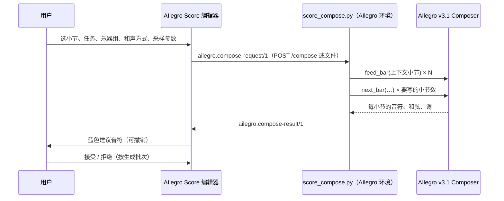

# 与 AIlegro 的接口

AIlegro 是项目所有者的 AI 作曲 / 续写 / 配器系统（同级文件夹 `../AIlegro`，有自己的
`AGENTS.md`）。**AIlegro Score 不修改 AIlegro 项目**，只通过这里定义的三个版本化 JSON 契约
和一个参考适配器与它交互。

代码：`packages/ailegro-bridge`（契约与转换）、`apps/web/src/state/ailegro.ts` +
`panels/AilegroPanel.tsx`（编辑器面板）、`integrations/ailegro/score_compose.py`（适配器）。
决策：[ADR 0005](adr/0005-ailegro-contract.md)。

## 工作流程



### A. 本机服务器（推荐，一键生成）

```sh
cd "<…>/software develop/AIlegro"
.venv-training/bin/python "../AIlegro Score/integrations/ailegro/score_compose.py" \
  --serve --checkpoint training/runs/<run>/weights.pt
```

编辑器 → AIlegro 面板 → “本机 AIlegro 服务” 填 `http://127.0.0.1:8765` → “连接” → “直接生成”。
模型只加载一次；一次只跑一个生成；默认只接受来自 `localhost` / `127.0.0.1` 页面的请求。

### B. 文件交换（不开服务器）

1. 面板 → “导出请求 (.json)”，得到 `ailegro-request-<id>.json`；面板会显示要运行的命令。
2. 在 AIlegro 文件夹运行：
   ```sh
   .venv-training/bin/python "../AIlegro Score/integrations/ailegro/score_compose.py" \
     --request ~/Downloads/ailegro-request-<id>.json \
     --checkpoint training/runs/<run>/weights.pt --output ~/Downloads/ailegro-result-<id>.json
   ```
3. 面板 → “导入生成结果 (.json)”。请求 id 对应的“乐器组 → 乐器”映射保存在浏览器里，
   所以结果会落到当初指定的乐器上。

### C. 只导出乐谱记录

面板 → “导出乐谱记录 (.json)”：`ailegro.score-record/1`，可作为 AIlegro 的分析/训练材料
（与 AIlegro 的 classical-score-v1 读取器兼容）。

### 不用模型测试整个流程

```sh
python3 integrations/ailegro/score_compose.py --serve --mock     # 占位音乐（音阶 + 主音低音）
python3 integrations/ailegro/score_compose.py --request r.json --dry-run --ailegro-root ../AIlegro
```

## 共同约定（与 AIlegro 训练代码一致）

| 方面 | 约定 |
| --- | --- |
| 时间 | **四分音符**为单位的精确分数字符串（`"3/2"`），从不使用浮点数。编辑器内部是全音符单位，导出时 ×4。 |
| 音高 | **发声** MIDI（60 = C4）；无音高打击乐 `pitch: null` + GM 鼓号 `drum`。记录里另带 `writtenPitch`。 |
| 乐器组 | AIlegro 的六个组：`woodwinds`、`brass`、`percussion`、`keys`、`high_strings`、`low_strings`。由乐器目录的 `ailegroGroup` 决定（人声目前不映射）。 |
| 声部身份 | `part` / `staff` / `voice` 保持稳定，AIlegro 用 `(part, staff, voice)` 作为 identity。 |
| 连线 | 一个发声的音一个音符：连线合并。 |
| 连音 | `tuplet: "3:2"` 这样的记谱比例，时值仍是实际值。 |
| 力度 | AIlegro 的力度词表（`p`、`f`、`pp`、`ff`、`sf`、`mf`、`fz`、`fff`、`fp`、`ppp`、`mp`、`sfp`、`sfz`、`rf`、`rfz`……）和 `crescendo` / `diminuendo`。 |
| 重音 | `accent`: 0 无、1 accent、2 strong（marcato）。 |
| 和弦 | 根音音级 0–11 + AIlegro 和弦性质 id（40 种，**顺序与 `training/data/chord-qualities.json` 一致**；AIlegro 采样器用下标报告性质）。 |
| 缺失信息 | 不知道就是 `null` / 不写，**不猜**。 |
| 来源 | 未接受的 AI 建议默认**不**作为材料导出（`defaultInclude`）。 |

## 契约 1：`ailegro.score-record/1`

`buildScoreRecord(doc, { bars?, parts?, include?, roles?, exportedAt? })`

| 字段 | 说明 |
| --- | --- |
| `schema`, `scoreId`, `source` | 固定 schema 名、乐谱 id、来源（`ailegro-score`） |
| `composer`, `work`, `movement`, `compositionKey`, `scoreSha256` | 元数据（未知为 null） |
| `parts[]` | `id`、`name`、`sound`（MusicXML 乐器音色 id，如 `strings.violin`）、`group`、`program`（GM，1 起）、`mapping`、`instrument`、`staves` |
| `measures[]` | `number`（1 起）、`on`、`dur`、`meter: [4, 4]`、`key: { fifths, mode }`（实际音高调号）、`irregular`（弱起等） |
| `notes[]` | `part`、`staff`、`voice`、`bar`（0 起）、`on`、`dur`、`pitch`、`writtenPitch`、`group`、`role`、`tuplet`、`dynamic`、`wedge`、`accent`、`grace`、`unpitched`；扩展：`drum`、`velocity`、`id`（音符 id，便于回指）、`source` |
| `harmony[]` | `bar`、`on`、`root`、`rootName`、`quality`、`bass`、`id`（扩展，供作曲请求使用） |
| `tempo[]` | `on`、`qpm`（每分钟四分音符数）、`text` |
| `provenance` | `app`、`exportedAt`、`license` |

已用 AIlegro 的 `score_events_v2.ScoreEvents.from_candidate` 读取过三个示例导出（钢琴、弦乐四重奏、管弦乐）。

## 契约 2：`ailegro.compose-request/1`

`buildComposeRequest(doc, spec, { requestId, createdAt, appVersion })`

```jsonc
{
  "schema": "ailegro.compose-request/1",
  "requestId": "ai_k3…",
  "client": { "app": "AIlegro Score", "version": "0.1.0" },
  "task": "continue",                     // 见下表
  "intent": null,                         // 预留：文字意图与标签
  "score": { /* score-record：上下文小节 + 生成区间内的给定材料 */ },
  "material": [                           // 已知材料（条件）
    { "id": "context", "kind": "notes", "timeSpan": { "from": "0", "to": "32" },
      "known": true, "hardLock": true, "source": "score" }
  ],
  "constraints": [                        // 每个要写的小节的调与拍号，另有乐器组、密度、风格、参考小节、速度
    { "id": "key-8", "kind": "key", "timeSpan": { "from": "32", "to": "36" },
      "value": { "tonic": 7, "mode": 0, "fifths": 1 }, "known": true, "hardLock": true, "source": "score" },
    { "id": "meter-8", "kind": "meter", "timeSpan": { "from": "32", "to": "36" }, "value": [4, 4], … },
    { "id": "groups", "kind": "groups", "value": { "allowed": ["keys"], "request": false }, … }
  ],
  "generate": {
    "bars": { "from": 8, "count": 4 },   // 小节下标，可超出乐谱末尾（结果会追加小节）
    "chordMode": "free",                 // free | hold | bar | given
    "sampling": { "seed": 1, "temperature": 0.9, "topP": 0.95 },
    "referencePolicy": "auto", "maxNotesPerBar": 128, "modelKeys": false, "contextBars": 8
  },
  "targets": [ { "group": "keys", "parts": ["pt_1"] } ]   // 每个组的音乐写到哪些乐器
}
```

- 每个条件都有 `timeSpan`（四分音符）、`known`、`hardLock`（必须严格保持 / 软提示）、`source`，
  与 AIlegro 的统一请求契约一致。
- 上下文最多 511 小节（`contextBars`）。
- 追加到乐谱末尾之后的小节，沿用最后一小节的拍号和调号，并带 `key-<i>` / `meter-<i>` 约束。

### 任务

| `task` | 含义 | 给定材料 | 适配器状态 |
| --- | --- | --- | --- |
| `continue` | 在上下文之后自由续写 | 上下文小节 | ✅ 支持 |
| `melody-from-chords` | 按乐谱上的和弦记号写旋律与伴奏 | 和弦（hardLock） | ✅ 支持 |
| `accompany-melody` | 旋律已给定（锁定），写其他声部 | 所选乐器的音符 | ⏳ 需要 AIlegro 解码器支持“生成区间内的锁定音符” |
| `develop-motif` | 发展一个动机 | 上下文里的动机 | ⏳ 同上 |
| `orchestrate` | 把已有音乐配器到所选乐器组 | 所选乐器的音符 | ⏳ 同上 |

## 契约 3：`ailegro.compose-result/1`

```jsonc
{
  "schema": "ailegro.compose-result/1",
  "requestId": "ai_k3…",
  "model": { "name": "four-pillar-v3.1", "checkpoint": "…/weights.pt", "sha256": "…", "step": 123000 },
  "seed": 1,
  "startBar": 8,
  "bars": [                                // 与 v3.1 Composer.next_bar() 的返回一致
    { "bar": 0, "length": "4", "meter": [4, 4], "key": { "tonic": 7, "mode": 0 },
      "chords": [ { "onset": "0", "root": 7, "quality": 0 } ],
      "notes": [ { "onset": "0", "duration": "1", "group": "keys", "voice": 0, "pitch": 74,
                   "drum": null, "velocity": 76, "dynamic": null, "accent": 0, "wedge": null } ] }
  ],
  "warnings": []
}
```

`onset` 相对小节开头（四分音符），`quality` 可以是下标或 id。

### 导入规则（`planComposeImport`）

1. 结果超出乐谱末尾时先追加小节。
2. **组 → 乐器**：用请求里的 `targets`；没有则按乐器所属组。每个组的“声部槽”（`group:voice`）
   按中位音高从高到低轮流分给该组的乐器。
3. 键盘类多谱表乐器按中央 C 分上下谱表；**声部号在每个谱表内重新排名**（所以钢琴左手是下谱表的
   声部 1，而不是声部 2）。
4. 量化（默认 `notation`）：二进制时值保持；接近 1/12 四分音符网格的视为三连音；其余对齐到
   1/32 音符。`exact` 保留原值。检测三连音区间并建立连音组。
5. 同一声部重叠时先换到空闲声部，实在不行截短前一个音（并给出警告）。
6. 音高按结果的调和当时的和弦拼写；`accent` → accent / marcato；力度变化时加力度记号；
   和弦写进和弦记号轨。
7. 默认先清空目标谱表在这些小节里的内容（`clearTargets`）。
8. 所有内容带 `source: { kind: 'ai', model, runId, accepted: false }`，整个导入是**一个撤销步骤**。
   面板里“接受”= `provenance.accept`，“拒绝”= `provenance.reject`（删除未接受的内容）。

## 适配器 `score_compose.py` 做了什么

- `prepare()`：校验 schema 和任务；按 AIlegro 的**提交顺序**整理上下文小节的事件——同一时刻先和弦变化，
  再无音高打击乐，再有音高的音（从低到高）；时间通过 AIlegro 的 `TimeVocabulary.lookup` 映射到词表
  （统计被映射到最近值的次数）；和弦性质 id → AIlegro 下标；未知的 GM 鼓号用 38（军鼓）。
- 调：优先用 `key-<bar>` 约束，其次用记录里小节的调号；`modelKeys` 时允许模型在小节边界换调。
- 生成：`Composer(model, vocab, seed, key=…)`；上下文逐小节 `feed_bar(events, length, meter, tempo, key)`；
  每个目标小节 `next_bar(length, meter, tempo, groups, request_groups, density, key, chord_mode, chords,
  style, max_notes, temperature, top_p, reference)`。`chordMode: given` 时把乐谱和弦作为 `chords` 传入。
- 服务器：`GET /health`、`POST /compose`；422 = 请求无法执行（例如不支持的任务），400 = 格式错误，
  500 = 生成失败；CORS 只放行回环地址（`--allow-origin` 可加）。

## 验证状态与检查清单

- ✅ 转换层（dry run）对照 AIlegro 真实的时间词表、和弦性质表和乐谱读取器验证过；示例上下文 0 次映射。
- ✅ 编辑器 ↔ 服务器 ↔ 导入 ↔ 接受/拒绝 的完整往返，用 `--mock` 在浏览器里测试过。
- ⚠️ **尚未用训练好的权重从本仓库跑过生成。** 第一次在 AIlegro 环境运行时请检查：
  1. `four_pillar_v31_sample.load()` 的返回值是否仍是 `(model, vocab, weights)`；
  2. `Composer.feed_bar` / `next_bar` 的参数名与上面一致；
  3. `next_bar` 返回的时间是 `Fraction`（会被写成 `"3/2"` 字符串）；
  4. 生成 2–4 小节后在编辑器导入，看声部分配和拼写是否合理。
  有出入时改适配器（本仓库），**不要改 AIlegro**；契约字段要变就按下面的规则升版本。

## 修改契约的规则

1. 新字段、字段含义变化、删除字段 → 新 schema 版本（`…/2`），旧版本的读取要保留或迁移。
2. 同时更新：`bridge/schemas.ts`、构建/导入代码、`bridge.test.ts`、适配器、本文档。
3. 与 AIlegro 侧的约定（时间单位、组、和弦表顺序）有变化时，先在 AIlegro 的文档里确认，
   再在这里记录来源。

## 未决问题

- 生成区间内的**锁定音符**（伴奏、配器、动机发展需要）——等待 AIlegro 解码器支持。
- 声部“角色”（旋律 / 低音 / 和声）目前只在记录里预留 `role` 字段，界面尚未提供。
- 文字意图（`intent`）与风格标签需要 AIlegro 侧定义词表。
- 人声目前不映射到任何组。
