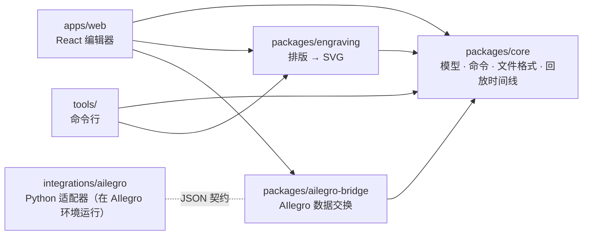

# 整体架构

## 包与依赖方向



| 包 | 职责 | 允许的依赖 |
| --- | --- | --- |
| `@ailegro-score/core` | 数据模型、有理数时值、音高拼写、乐器目录与模板、**命令**与撤销/重做（`Session`）、`.ailegro.json` 读写、文字记谱、回放时间线、示例乐谱 | 仅 `immer` |
| `@ailegro-score/engraving` | `ScoreDoc` → 分行分页的图形 → SVG；输出命中测试用的几何信息 | `core` |
| `@ailegro-score/ailegro-bridge` | 三个版本化契约：乐谱记录、作曲请求、生成结果导入 | `core` |
| `@ailegro-score/web` | 编辑器界面：状态（zustand）、键盘/鼠标输入、面板、回放（Web Audio）、文件 | 以上全部 + React |
| `tools/` | Node 命令行：无界面渲染（SVG/PNG） | `core`、`engraving`、`sharp` |
| `integrations/ailegro` | 参考适配器 `score_compose.py`：把请求喂给 AIlegro 的 v3.1 Composer | 只 import AIlegro 模块 |

`packages/*` 是**纯 TypeScript**：不能用 DOM、Node API、React、`localStorage`。
由 `packages/tsconfig.json`（不含 DOM lib、`types: []`）和 ESLint 规则共同保证。
这样核心逻辑可以在浏览器、Node、Web Worker、未来的协作服务器里原样运行。

## 数据流

```text
                ┌──────────── 用户输入（键盘 / 鼠标 / 文字 / AIlegro 结果）
                ▼
 apps/web actions ──► Command（纯 JSON，带调用方生成的 id）
                ▼
 core Session.dispatch ──► applyCommand（immer produceWithPatches）
                │              ├─ 校验失败：抛 CommandError，文档不变
                │              └─ 成功：新文档 + patches + inverse patches（撤销栈）
                ▼
             ScoreDoc（唯一事实来源，不可变，结构共享）
                ├─► engraving.layoutScore(doc, options) ─► PageLayout ─► renderPageSvg ─► 屏幕 / 导出
                ├─► core.buildPlayback(doc) ─► Web Audio 调度
                ├─► core.serializeScore(doc) ─► .ailegro.json（保存 / 自动保存 / git）
                └─► bridge.buildScoreRecord / buildComposeRequest ─► AIlegro
```

### 一次按键的旅程（例：输入模式下按 `D`）

1. `keyboard/shortcuts.ts` 把 `d` 映射到 `actions.enterLetter('D')`。
2. `actions.ts` 根据光标位置、上一个音（`pitchBefore`）、调号、谱号、是否移调乐器
   算出音高（`pitchForLetter`），生成 `note.enter` 命令（事件 id、音符 id 由 `store.ids` 生成）；
   如果音符超出或刚好写满乐谱末尾，同一批命令里加 `measures.insert`（光标才有地方继续）。
3. `store.apply()` → `Session.dispatch()`：一个撤销步骤；记录撤销前后的选择与光标。
4. React 重新渲染：`ScoreView` 重新排版（`useMemo` 以文档为键）、生成每页 SVG；
   未变化的页面字符串相同，DOM 不更新。
5. 光标前进到下一个位置；`previewMidi` 播放这个音。

## 关键不变量（详见 [AGENTS.md](../AGENTS.md)）

1. 文档是唯一事实来源；其他都是推导。
2. 所有修改走命令；命令确定、可序列化（id 在 payload 里，处理函数里没有随机数、时间、I/O）。
3. 时间是精确有理数（全音符为 1，四分音符 = 1/4）。
4. 存实际音高（带拼写），记谱音高由移调推导。
5. 一个发声的音 = 一个事件；跨小节线的连线由排版推导；休止符是隐式的空隙。
6. 排版是纯函数，相同输入产生相同字节（快照测试、视觉对比有意义）。
7. 契约有版本号；改字段 = 新版本 + 迁移 + 测试 + 文档。

## 为什么这样设计

- **命令 + 稳定 id** 一次性解决了撤销/重做、AI 补丁（AIlegro 结果就是一批命令）、版本历史、
  实时协作四个需求。见 [ADR 0004](adr/0004-commands-and-history.md)。
- **自研排版引擎**而不是 VexFlow/Verovio：需要控制总谱排版、命中测试几何、AI 建议的样式、
  确定性输出，并且能按需优化大总谱。见 [ADR 0003](adr/0003-own-engraving-engine-smufl.md)。
- **monorepo + 纯 TS 包**：核心能被测试、命令行、浏览器、未来的服务器共用。
  见 [ADR 0001](adr/0001-monorepo-typescript.md)。

## 性能现状与方向

- 每次编辑都会对整份乐谱重新排版。实测（Chromium）：示例管弦乐 6 小节 12 行谱表，按键到绘制
  约 30–70 ms；200 小节钢琴曲（约 1800 个音）排版约 70–120 ms、SVG 约 10 ms。
- 大总谱需要**增量排版**：以 immer 结构共享的 `StaffMeasure` 对象为键缓存每小节的记谱与
  间距列，只重新做分行和对齐；再把排版放进 Web Worker。路线图任务 `M2-ENG-01`、`M2-WEB-04`。

## 怎么加一个功能（配方）

| 想做 | 步骤 |
| --- | --- |
| 新的编辑操作 | `core/src/commands/types.ts` 加命令类型 → `content.ts` 或 `structure.ts` 写处理函数 → `apply.ts` 注册 → `commands.test.ts` 加测试 → `apps/web/src/state/actions.ts` 调用 → 快捷键/按钮 → 中英文字符串 |
| 新的排版规则 | `engraving/src/layout/*` 改规则 → `engraving.test.ts` 加测试 → `npm run render -- --all --out out/` 看图 |
| 新的记谱元素（如歌词） | 模型字段（`score-model.md`、文件格式版本）→ 命令 → 排版 → 编辑器 → AIlegro 记录是否导出。连线、线条、倚音是现成的例子（[ADR 0007](adr/0007-marks-graces-spanners.md)） |
| 新的 AIlegro 任务 | `bridge` 的 `ComposeTask` 和请求构建 → 契约文档 → 适配器支持 → 面板选项 |
| 新的界面面板 | `apps/web/src/panels/` 新组件 → `SidePanel.tsx` 注册 → `i18n` 中英文 |
