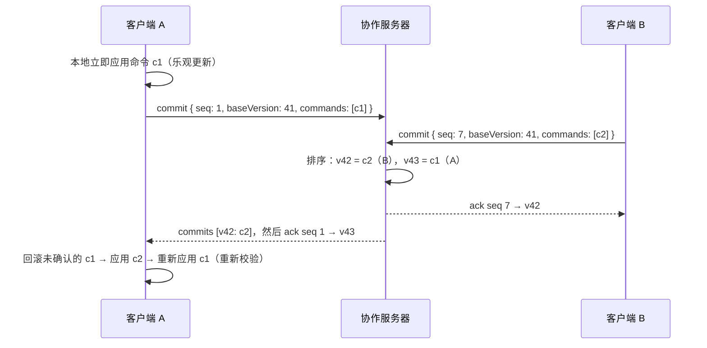

# 版本历史、对比与实时协作（设计）

状态：**设计阶段**。已具备的基础：命令系统（`core/commands`）、带 patches 的撤销历史
（`Session`）、稳定 id、规范化的 `.ailegro.json`。本文定义接下来的实现方式和任务拆分。

## 为什么“命令 + 稳定 id”是基础

- 每次修改都是一个**纯 JSON 命令**，新元素的 id 写在命令里 → 同一命令作用在同一文档上，结果必然相同。
  所以命令可以记录、传输、在别人的机器上重放。
- 每个元素的 id 永不改变（改音高保留音符 id，改时值保留事件 id）→ 两个版本之间可以按 id 对齐，
  得到“第 12 小节第一小提琴的 E 改成了 F#”这种**语义对比**，而不是文本行对比。
- `applyCommand` 同时产出 immer patches 和反向 patches → 撤销、回滚、重放都有现成的工具。

## 一、版本历史

### 三个层次

| 层次 | 内容 | 现状 |
| --- | --- | --- |
| 撤销历史 | 本次编辑会话的命令与 patches（最多 500 步），撤销时恢复选择和光标 | ✅ 已实现 |
| 命名版本 | “检查点”：完整快照 + 标签 + 时间 + 作者 + 来源（人 / AI 运行） | 计划 `M3-HIST-01` |
| git | `.ailegro.json` 文件提交到仓库，每个事件一行，可逐音比较 | ✅ 文件格式已就绪 |

### 命名版本的存储

- 版本 = 规范化 JSON 快照（压缩后很小，且永远可读，不依赖命令语义的演变）。
  可选地附上从父版本到它的命令列表，用于“这一版做了什么”的说明。
- 浏览器内保存在 IndexedDB（按文档 id），可导出为 `<name>.ailegro-history.json`。
- 自动版本：接受一次 AI 生成、打开文件、每 N 分钟有修改时，各自动建一个版本。

## 二、语义对比（diff）

`core` 新增 `diffScores(a, b): ScoreDiff`（`M3-HIST-02`），按 id 对齐：

| 对象 | 变化类型 |
| --- | --- |
| 乐器 / 谱表 | 增加、删除、改名、改谱号 |
| 小节 | 增加、删除；拍号、调号、速度、小节线、排练号变化 |
| 事件 | 增加、删除、移动（小节/offset 变化）、时值变化、演奏法变化、来源变化（接受 AI） |
| 音符 | 增加、删除、音高变化、连线变化 |
| 和弦记号、力度、谱号变化 | 增加、删除、修改 |

输出既有逐项列表，也有“谱表 × 小节”的汇总矩阵，供界面着色。

### 对比界面（`M3-HIST-03`）

- **叠加模式**：在当前乐谱上标出变化：新增绿、删除红（虚影）、修改琥珀色；AI 来源蓝色描边。
- **并排模式**：两份排版左右对照，滚动同步。
- 版本时间线面板：选择任意两个版本对比，或“与上一版比较”。

### git 里的语义对比（`M3-HIST-04`）

`tools/score-diff.ts`：`npm run score-diff -- old.ailegro.json new.ailegro.json` 打印人能读的变化清单。
可配置为 git 外部 diff 驱动，在 `git diff`、PR 审阅中直接看到乐谱语义变化。

### 三方合并（`M3-HIST-05`）

base / ours / theirs 按 id 合并：不同元素的修改直接合并；同一元素的不同修改、或同一声部同一时间段
的插入，标为冲突，在界面里逐个选择。用于 git 分支合并，也用于离线协作的重新连线。

## 三、多人实时协作

### 模型：服务器排序的命令日志 + 客户端重放



- 服务器是权威：给每个提交分配全局版本号，广播给所有客户端，持久化日志和定期快照。
- 客户端乐观应用自己的命令；收到别人的命令时，**回滚未确认的本地命令（反向 patches）→ 应用远端命令 →
  重新执行本地命令**。命令是确定的且按 id、按“小节 + offset”寻址，大部分情况下重放结果符合原意。
- 重放失败（例如对方删了我正在写的小节）→ 丢弃该命令并提示用户。
- 携带“推导数据”的命令（如改拍号时的 `newMeasureIds` 数量依赖当时的乐谱长度）在重放时需要
  从用户意图重新生成：客户端保存待确认操作的 action 级意图，失败时重新计算命令。

### 为什么不用 CRDT（Yjs / Automerge）

乐谱有很强的不变量：一个声部里事件不能重叠、小节结构会被“改拍号重新划分小节线”整体改变、
连音组不能跨小节线。CRDT 的自动合并可能得到**合法的 JSON 但不合法的乐谱**；
命令重放每一步都经过同样的校验，始终保持不变量。文字类字段（标题）将来可以单独用 CRDT。

### 协议草案（`M4-COLLAB-01`）

客户端 → 服务器：

```jsonc
{ "type": "hello", "docId": "sc_…", "clientId": "c_…", "user": { "name": "…", "color": "#…" }, "since": 41 }
{ "type": "commit", "seq": 1, "baseVersion": 41, "label": "enter note", "commands": [ /* Command[] */ ] }
{ "type": "presence", "selection": { "kind": "notes", "noteIds": ["n_…"] }, "cursor": { /* ScorePosition */ } }
```

服务器 → 客户端：

```jsonc
{ "type": "snapshot", "version": 41, "doc": { /* ScoreDoc */ } }
{ "type": "commits", "entries": [ { "version": 42, "clientId": "c_…", "seq": 7, "commands": [] } ] }
{ "type": "ack", "seq": 1, "version": 43 }
{ "type": "reject", "seq": 1, "reason": "CommandError: …" }
{ "type": "presence", "clientId": "c_…", "user": {}, "selection": {}, "cursor": {} }
```

### 其他要点

- **在线状态**（`M4-COLLAB-04`）：显示别人的光标与选择（按 id），用各自的颜色；
  可选的“软锁”：别人正在输入的声部高亮提示。
- **按用户撤销**（`M4-COLLAB-05`）：只撤销自己的命令；若后续命令触及同一位置，
  生成补偿命令或提示无法撤销。
- **AI 作为参与者**：AIlegro 的一次生成就是一个提交（标记为建议），所有人都能看到并审阅。
- **离线**：命令排队；重新连线后重放，冲突太多时转为三方合并界面。
- **权限**：v1 只面向互相信任的协作者（带 token 的链接）；账号与权限以后再定。

## 任务拆分

| id | 任务 | 依赖 |
| --- | --- | --- |
| `M3-HIST-01` | 命名版本：IndexedDB 存储、自动版本、时间线面板 | — |
| `M3-HIST-02` | `diffScores`（core，纯函数）+ 单元测试 | — |
| `M3-HIST-03` | 对比界面：叠加 / 并排 | 01、02 |
| `M3-HIST-04` | `tools/score-diff.ts` 与 git 外部 diff 配置说明 | 02 |
| `M3-HIST-05` | 三方合并（core）+ 冲突界面 | 02 |
| `M4-COLLAB-01` | 协议定稿（本节草案 → 版本化 schema） | — |
| `M4-COLLAB-02` | 协作服务器（Node + WebSocket，日志 + 快照持久化） | 01 |
| `M4-COLLAB-03` | 客户端同步与本地命令重放 | 02 |
| `M4-COLLAB-04` | 在线状态（远端选择与光标） | 03 |
| `M4-COLLAB-05` | 按用户撤销 | 03 |
